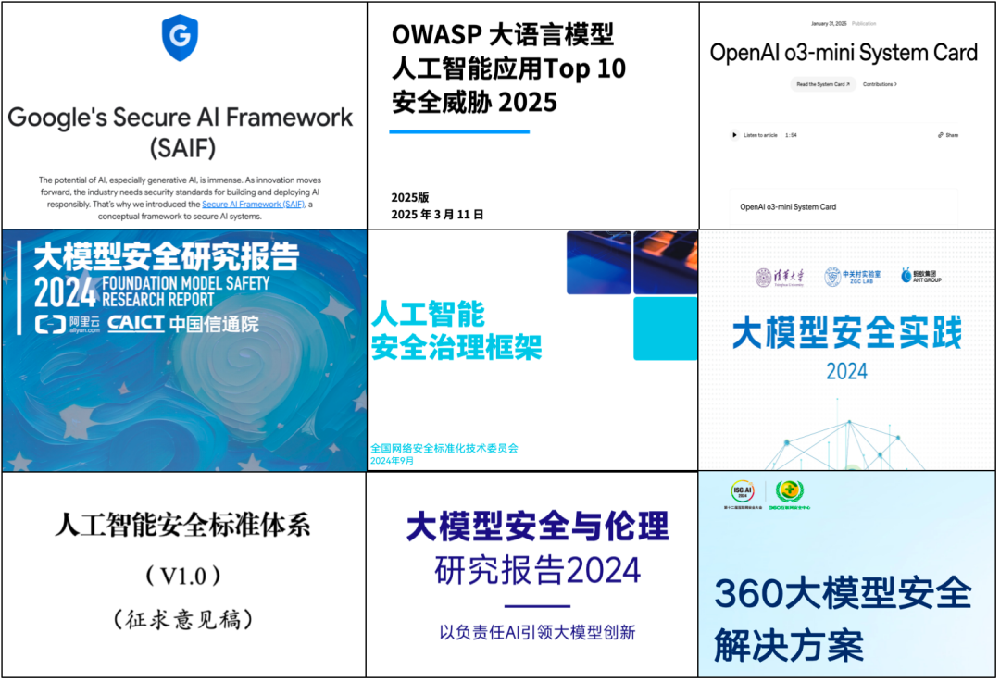
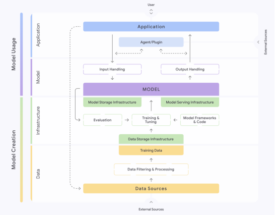
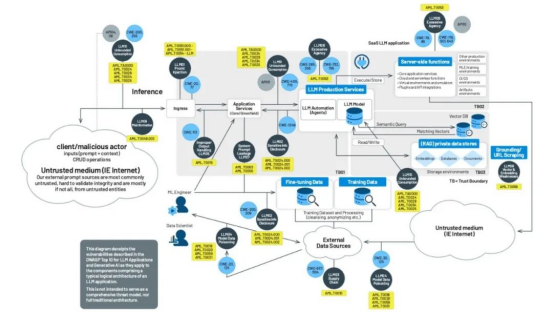
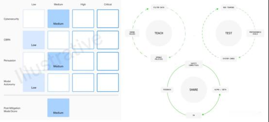
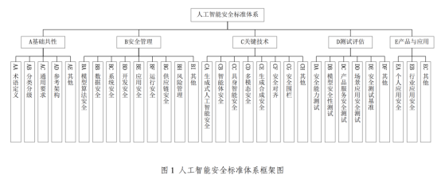
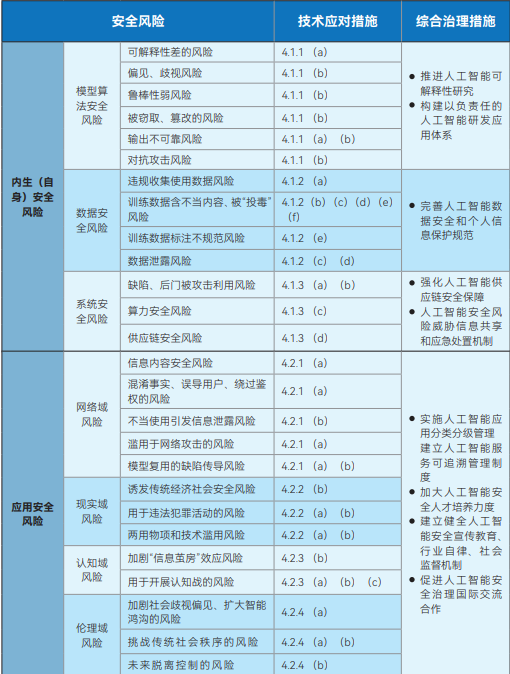
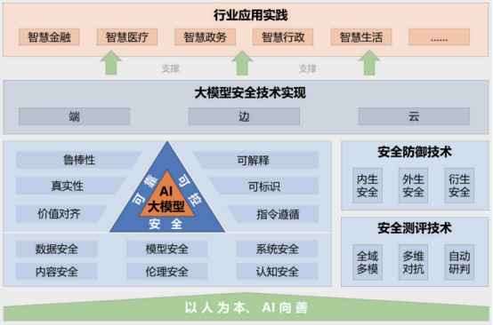
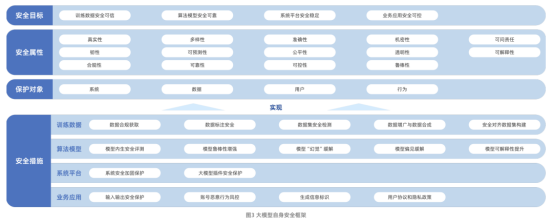
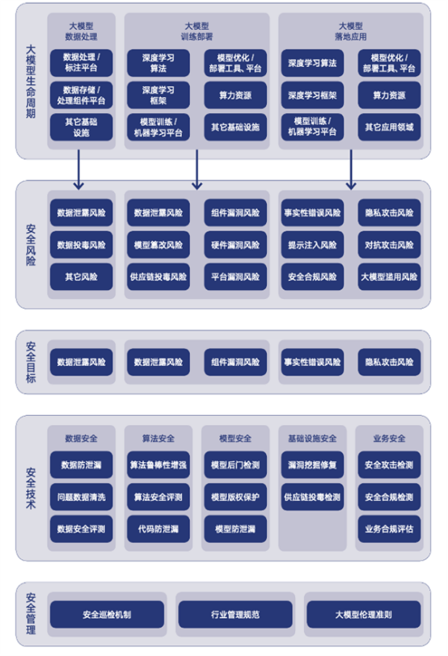
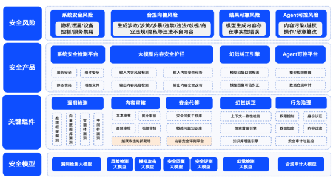

# 九个大模型安全框架解读

## 一、前言

大模型的安全问题，已经不再只是技术人员的“幕后焦虑”，而逐渐成为产业界、政策制定者与普通用户都必须面对的现实。如何防范模型被投毒？如何确保训练数据合规？如何避免“AI 失控”？

近两年，国内外学术机构、企业和监管组织纷纷提出各类大模型安全框架。它们有的侧重技术，有的着眼治理，有的强调伦理。

本文将系统梳理当前最具影响力的 **九大框架**，并从维度、特点和适用场景进行分析。

## 二、九大安全框架详解

### 1. Google Secure AI Framework (SAIF, 2025.4)

* **核心理念**：将 AI 系统拆解为 **数据、基础设施、模型、应用** 四层，逐层分析风险。

* **亮点**：明确了 15 大风险（数据中毒、模型篡改、提示注入、敏感数据泄漏等），并给出相应的 15 类防控措施。

* **适用场景**：适合技术驱动型企业在研发与落地环节进行 **全链路风险扫描**。

### 2. OWASP Top 10 LLM 安全威胁 (2025.3)

* **核心理念**：借鉴 Web 安全领域的经验，将大模型应用拆解为 **多个信任域**（服务、插件、数据库、外部数据源），重点识别交互中的高危点。

* **十大风险**：提示词注入、敏感信息泄露、供应链风险、模型投毒、不当输出、过度授权、系统提示泄漏、嵌入漏洞、信息误导、无限资源消耗。

* **适用场景**：为开发者与安全团队提供一份 **最常见威胁的清单**。

### 3. OpenAI 模型安全框架 (System Card, updating)

* **核心理念**：从 **CBRN（大规模杀伤性风险）、网络攻击、说服力、自主性** 四个维度评估。

* **运作机制**：每次模型发布前，都要通过 **价值观对齐 → 对抗评估 → 管控迭代** 三步走，生成一份 System Card。

* **特点**：强调“模型上线前必须经过全方位红蓝对抗”，并在部署后继续动态治理。

* **适用场景**：适合在 **商业大模型落地** 前进行合规化审查。

### 4. 人工智能安全标准体系 V1.0（网安标委, 2025.1）

* **核心理念**：与网络安全国家标准体系衔接，形成一套覆盖 **基础共性、安全管理、关键技术、测试评估、产品应用** 的综合体系。

* **重点维度**：

  * 管理：算法安全、数据安全、系统安全、供应链安全；

  * 技术：生成式 AI 安全、智能体安全、多模态安全、安全围栏。

* **适用场景**：监管与企业 **合规落地** 的参考依据。

  

### 5. 人工智能安全治理框架（网安标委, 2024.9）

* **风险划分**：内生风险（模型本身：算法、数据、系统）+ 应用风险（网络域、现实域、认知域、伦理域）。

* **治理理念**：不仅靠技术，更要多方共治——研发机构、服务商、用户、政府、行业协会共同参与治理。

* **适用场景**：宏观治理层面的政策框架，适合 **行业规范与政策制定**。

### 6. 大模型安全实践 2024（清华大学&中关村实验室&蚂蚁集团, 2024.11）

* **核心理念**：安全不仅是底层技术，更是“以人为本、AI 向善”的体系构建。

* **五大部分**：建设指导思想、安全技术体系、安全测评与防御、端边云安全、多行业应用。

* **覆盖风险**：数据泄漏、模型投毒、指令攻击、窃取攻击、硬件/软件漏洞、虚假信息、意识形态风险、诈骗、知识产权侵犯等。

* **适用场景**：研究机构与大厂的 **实践落地经验总结**。

### 7. 大模型安全研究报告（阿里云&信通院, 2024.9）

* **四大维度**：数据安全、模型安全、系统平台安全、业务应用安全。

* **亮点**：首次提出“大模型安全不仅保护自身，还能反哺网络安全”。

* **适用场景**：企业级 **云端安全治理** 与产品化参考。

### 8. 大模型安全与伦理研究 2024（腾讯研究院, 2024.1）

* **核心理念**：安全问题与伦理问题不可分割。

* **内容**：梳理 15 类风险（数据泄漏、供应链投毒、硬件漏洞、平台漏洞等），提出四类最佳实践：

  * Prompt 安全测评

  * 蓝军攻防演练

  * 源码防护实践

  * 基础设施安全方案

* **适用场景**：偏 **研究与伦理治理**，适合政策讨论和学术探索。

### 9. 360 大模型安全解决方案（updating）

* **风险划分**：系统安全、内容安全、可信安全、可控安全。

* **产品矩阵**：

  * **智鉴**：生态链漏洞检测

  * **智盾**：内容安全防护

  * **智搜**：可信安全评估

* **特点**：较早推出 **完整的安全产品组合**，将框架直接转化为工具。

* **适用场景**：企业 **落地级安全解决方案**。

## 三、比较与趋势

| 框架               | 主要提出方   | 特点                 | 适用场景      |
| ---------------- | ------- | ------------------ | --------- |
| SAIF             | Google  | 全链路 15 风险点 + 防控措施  | 技术研发与应用落地 |
| OWASP Top 10     | OWASP   | 面向开发者的十大常见威胁       | 开发与测试环节   |
| OpenAI Framework | OpenAI  | System Card + 三步治理 | 商业大模型发布   |
| 安全标准体系 V1.0      | 网安标委    | 与国标衔接，标准化分类        | 监管/合规     |
| 安全治理框架           | 网安标委    | 内生 + 应用风险，全社会共治    | 政策治理      |
| 安全实践 2024        | 清华&蚂蚁   | 技术与应用结合，强调 AI 向善   | 行业实践      |
| 安全研究报告           | 阿里云&信通院 | 自身安全 + 赋能网络安全      | 云平台治理     |
| 安全与伦理研究          | 腾讯研究院   | 技术安全 + 伦理对齐        | 学术/政策     |
| 360 解决方案         | 360     | 产品化工具，解决方案导向       | 企业落地      |

## 四、总结与思考

* **趋同点**：所有框架都强调 **全链路防护** 和 **多方协同治理**。

* **差异性**：

  * 国际厂商（Google、OpenAI）强调 **技术全流程与实测**；

  * 国内机构（网安标委、信通院、清华、腾讯等）更关注 **治理、合规与伦理**；

  * 企业（360、阿里云）倾向于 **产品化落地**。

* **趋势**：框架正在从“原则性指南”走向“工具化落地”，未来可能形成国际/国内标准融合。

一句话总结：**大模型的安全框架已经从理念探索走向产品与治理并重的新阶段，真正的挑战是如何在创新与监管之间找到平衡。*

原文链接：https://mp.weixin.qq.com/s/1xC7SkqsYJKVIDE5xOGSAw*
