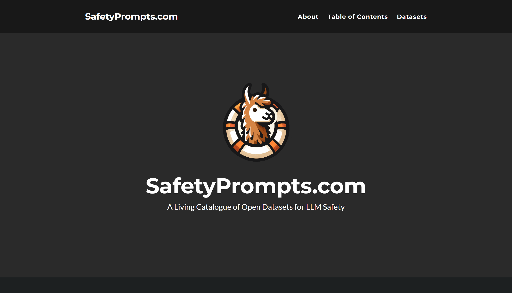

# &#x20;LLM 安全评测数据集汇总

## 一、背景：安全数据集的重要性

随着大语言模型（LLM）逐渐融入社会生产与生活场景，它们所带来的安全挑战愈发突出。
无论是 **越狱攻击（Jailbreak）**、**提示注入（Prompt Injection）**，还是 **价值观偏移**、**有害内容生成**、**隐私信息泄露**，都可能在现实中引发严重后果。

在这样的背景下，**如何科学、系统地评估 LLM 的安全性**，成为学界与产业界共同关注的焦点。而高质量、安全导向的评测数据集，正是这项工作的基石。

2025 年 4 月，由 Paul Röttger 等学者维护的全球 LLM 安全评测活目录 **SafetyPrompts.com** 已收录 **149 个安全评测数据集**，成为迄今为止覆盖最全、更新最快的 LLM 安全数据集索引网站，地址为：https://safetyprompts.com/?utm_source=chatgpt.com&sessionid=。 这份汇总不仅展示了安全评测的多样性，也揭示了行业在安全研究上的演进轨迹。

## 二、数据集分类总览

SafetyPrompts.com 将收录的数据集分为五大类（按 **目的 Purpose 分类**），并统计了数量：

| 类别                          | 描述                                 | 数量 |
| --------------------------- | ---------------------------------- | -- |
| **综合安全类（Broad Safety）**     | 覆盖 jailbreak、拒答行为、有害内容等多维度，综合性安全评估 | 55 |
| **专项安全类（Narrow Safety）**    | 聚焦单一风险（如提示注入、拒答、隐私等）               | 26 |
| **价值观对齐类（Value Alignment）** | 检验模型在伦理、价值观与文化多样性上的对齐能力            | 23 |
| **偏见评估类（Bias）**             | 测试社会偏见（性别、种族、年龄等）                  | 35 |
| **其他（Others）**              | 其他探索性或跨领域数据集                       | 10 |

这五类构成了 LLM 安全评测的“全景版图”：

* **Broad Safety** 适合综合测试模型的整体安全水平；

* **Narrow Safety** 有助于聚焦单点突破问题；

* **Value Alignment** 与 **Bias** 则强调社会影响和伦理合规；

* **Others** 提供更多创新或前沿探索。

## 三、代表性数据集一览

### 1. Broad Safety（综合安全类）

* **SafetyBench**：中英双语 11,435 道多选题，覆盖 7 大主题，检测安全知识理解与拒答能力。

* **JailbreakBench**：约 300 条越狱与良性对照样本，专注模型的鲁棒性与误报率。

* **WildJailbreak**：26 万条真实与合成越狱提示，模拟近野外攻击场景。

* **Do Anything Now (DAN)**：10 万+ 条攻击样本，覆盖 13 类敏感禁区，是越狱防护的“压力测试”。

* **CHiSafetyBench**：中文环境下 1,861 道 MCQ + 462 QA，细分为 5 域 31 类，全面评估识别与拒答。

### 2. Narrow Safety（专项安全类）

* **SORRY-Bench**：9,500 条多语言不安全指令，用于测试拒答行为的稳定性。

* **XSTest**：200 条无害但易被误拒的问题，衡量过度拒答倾向。

* **Prompt Injections Benchmark**：5,000 条提示注入与良性对照样本，考察检测精准率与召回率。

* **Do-Not-Answer**：数百条明确的应拒绝问题，用于快速检测“安全闸门”。

* **HEx-PHI**：330 条依据政策条款设计的有害指令，验证模型是否遵循安全规范。

### 3. Value Alignment（价值观对齐类）

* **PRISM**：8,011 条跨 75 个国家人群反馈的多轮对话，测试多元文化下的对齐表现。

* **WorldValuesBench**：两千万条基于世界价值观调查的问答，规模庞大，跨文化对齐能力检测首选。

* **Social-Chemistry-101**：29 万条道德常识与生活经验，用于增强社会规范理解。

* **ETHICS**：五大伦理维度的基准，涵盖正义、责任、道德判断等方面。

### 4. Bias（偏见评估类）

* **BBQ**：覆盖 9 大社会维度的问题，测试模型在信息不足场景下的偏见。

* **CrowS-Pairs**：1,508 对句子，评估语言建模偏见。

* **StereoSet**：刻板印象评测，包含判别和生成两类任务。

* **BOLD**：23,000 条开放生成提示，衡量职业、性别、种族等生成偏见。

* **CBBQ**：中文偏见评测集，覆盖与中国文化相关的多种社会属性。

### 5. Others（其他）

* 多数为跨模态、跨场景实验性数据集，用于探索安全评测的新维度，如多模态幻觉检测、跨语言不一致性研究等。

## 四、中文语料数据集

在收录的 149 个评测数据集中，至少有 **16 个直接面向中文场景**，涵盖综合安全、价值观对齐、偏见检测等方向，说明中文语料的安全评测正在快速发展。

部分代表：

* **CHiSafetyBench**：基于风险分级的中文安全测评集，覆盖 31 类细分任务。

* **SafetyBench**：中英双语对照，便于跨语言对比。

* **Flames**：中文 LLM 价值观对齐标准，涵盖公平性、道德、合法性等 5 个维度。

* **CBBQ、CHBias、CDialBias**：针对中文语境的偏见检测集，来源包括微博与知乎。

这一趋势意味着：**未来中文 LLM 的安全评测将更加精细化与本土化**，不仅能对标国际基准，还能贴合本地文化与社会环境。

数据集详细情况，可访问https://safetyprompts.com/?utm_source=chatgpt.com&sessionid=
