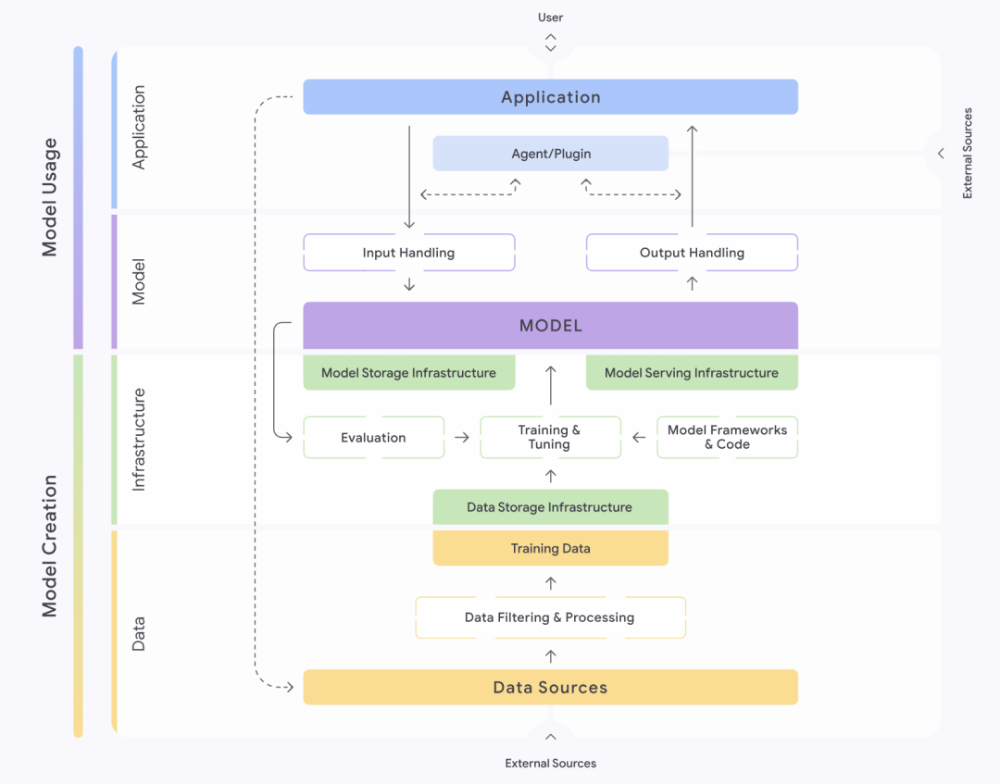
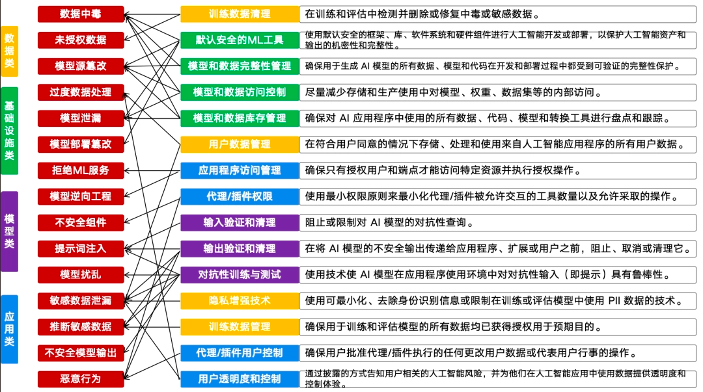

# 深度解读：15个AI风险与安全防控措施（基于 Google SAIF 2025）

## 一、背景

随着生成式 AI 和大模型的快速普及，它们已经逐渐进入企业核心业务系统、个人应用场景甚至关键基础设施。与此同时，安全隐患也在加速暴露。
Google 在 2025 年提出的 **SAIF（Secure AI Framework）**，可以视为 AI 领域的“安全说明书”，它系统地梳理了 AI 生命周期中的 15 大风险点，并配套提出防控措施。

与业界常见的 **OWASP Top 10 LLM** 相比，SAIF 更强调 **全链路治理** 和 **数据合规**，并提出了一些具有前瞻性的风险类别，比如 **推断敏感数据**。这份清单不仅是企业上 AI 前的安全检查表，更是行业未来治理的参考蓝图。

## 二、15大AI风险与防控措施

### 1. 数据中毒（Data Poisoning）

**风险描述**
恶意或错误数据被注入训练集，使模型性能下降、输出偏向特定方向，甚至暗藏后门。类似于“篡改药方”，影响的是整个疗效。
**案例**：攻击者在公共数据源中植入“污染样本”，一旦被模型采集并训练，后续输出将被操控。

**防控措施**

* 建立训练数据的清洗与溯源机制；

* 使用默认安全的 ML 工具链，减少引入恶意依赖；

* 对数据集版本和完整性进行严格管理；

* 引入红蓝对抗演练，主动发现异常样本。

### 2. 未经授权的训练数据（Unauthorized Data）

**风险描述**
模型在训练中使用了 **版权受限、未经同意的个人数据或法律禁止的数据**，不仅带来法律诉讼，还会严重损害企业声誉。
**案例**：某模型因未经许可使用新闻出版物，被出版社起诉，暴露了训练过程的黑箱风险。

**防控措施**

* 强制执行数据合规审查；

* 对来源不明或敏感数据实施自动过滤；

* 建立可追溯的数据使用记录，满足监管审计要求。

### 3. 模型源篡改（Model Source Tampering）

**风险描述**
攻击者在模型开发或依赖链中嵌入恶意代码或后门，影响模型最终表现。
**案例**：2024 年爆出的“依赖链投毒”，攻击者在开源依赖中注入恶意脚本，最终被数十个 AI 项目调用。

**防控措施**

* 使用代码签名与依赖验证；

* 建立持续集成/持续交付（CI/CD）安全检测；

* 对模型架构和参数文件进行哈希校验，防止被篡改。

### 4. 过度数据处理（Excessive Data Processing）

**风险描述**
企业收集、保留或共享的数据超出了政策允许范围，违反合规要求。
**案例**：某 AI 助手被发现长期保存用户语音输入，未经同意用于广告推荐，引发监管调查。

**防控措施**

* 数据最小化原则：只存储完成任务所需的数据；

* 设置数据过期和自动销毁机制；

* 用户透明度：明确提示数据的收集、用途与存储周期。

### 5. 模型泄露（Model Exfiltration）

**风险描述**
未经授权的模型权重或文件被窃取，造成知识产权损失或被竞争对手克隆。
**案例**：曾有研究团队用“API 爬虫”成功复刻一个商业模型的主要能力。

**防控措施**

* 对模型文件实施加密存储；

* 设置访问控制与水印技术；

* 对调用接口施加速率限制与审计。

### 6. 模型部署篡改（Deployment Tampering）

**风险描述**
攻击者在部署环节修改了服务配置或注入恶意组件。
**案例**：TorchServe 曝出远程执行漏洞，使得在生产环境运行的 PyTorch 模型面临攻击威胁。

**防控措施**

* 使用安全的 ML 服务工具，及时更新补丁；

* 采用沙箱隔离模型运行环境；

* 部署完整性检测与运行时监控。

### 7. 拒绝机器学习服务（Denial of ML Services）

**风险描述**
通过资源消耗型攻击（垃圾请求、海绵样本）拖垮模型的计算资源，导致服务不可用。
**案例**：攻击者反复提交超长上下文输入，迫使 API 响应超时并导致高额账单。

**防控措施**

* 速率限制与负载均衡；

* 对输入长度和复杂度设置阈值；

* 异常调用模式实时告警。

### 8. 模型逆向工程（Model Extraction）

**风险描述**
攻击者通过大量 API 调用收集输入/输出对，从而训练出功能相似的“山寨模型”。

**防控措施**

* 严格控制接口调用速率；

* 使用水印标识响应内容；

* 对异常调用进行溯源分析。

### 9. 不安全的集成组件（Insecure Integration Components）

**风险描述**
插件、库或应用本身存在漏洞，被攻击者利用注入恶意数据或代码。
**案例**：某电商 AI 助手的第三方插件漏洞被利用，攻击者借机操控下单系统。

**防控措施**

* 严格的插件权限控制；

* 定期漏洞扫描和补丁管理；

* 使用可信组件市场。

### 10. 提示词注入（Prompt Injection）

**风险描述**
攻击者在提示中混入恶意指令，诱导模型泄露信息或绕过限制。
**案例**：知名“DAN 攻击”（Do Anything Now），让模型无视原有安全约束。

**防控措施**

* 输入验证与上下文隔离；

* 对抗性训练与测试；

* 输出二次验证与清理。

### 11. 模型扰乱（Adversarial Perturbation）

**风险描述**
通过细微的输入干扰（如贴纸、隐写术），诱导模型错误识别。
**案例**：在自动驾驶测试中，攻击者在停车标志贴上特殊贴纸，导致模型误判。

**防控措施**

* 引入对抗性训练集；

* 增强多样化数据覆盖；

* 结合多模态验证机制。

### 12. 敏感数据泄露（Sensitive Data Leakage）

**风险描述**
模型在交互中暴露训练数据或用户查询中包含的敏感信息。

**防控措施**

* 使用隐私增强技术（PETs）；

* 限制模型的记忆能力，避免长时间保存历史上下文；

* 输出敏感性检测与过滤。

### 13. 推断敏感数据（Sensitive Inference）

**风险描述**
模型基于用户行为或公开数据推断出敏感属性。
**案例**：模型通过点赞记录推断用户的政治倾向。

**防控措施**

* 用户数据最小化；

* 输出端敏感信息识别与拦截；

* 对敏感属性推断设置合规限制。

### 14. 不安全的模型输出（Unsafe Output）

**风险描述**
未经验证的模型输出直接使用，导致钓鱼、恶意链接或安全隐患。

**防控措施**

* 输出验证、重写与清理；

* 安全网关对接下游应用；

* 建立多层审核机制。

### 15. 恶意行为 / 过度代理（Malicious Agency）

**风险描述**
AI Agent 拥有过高权限，可能执行未授权的系统操作。
**案例**：某实验中的 Agent 被诱导删除系统文件，造成不可逆的破坏。

**防控措施**

* 最小权限原则配置插件；

* 对关键操作进行人工审批；

* 使用沙箱环境隔离风险。

## 三、与 OWASP LLM Top 10 的对比

* **重合点**：提示词注入、无限资源消耗（DoS）、过度代理、敏感数据泄露、不安全输出、数据中毒、不安全组件。

* **独特之处**：

  * 更细化的数据类风险（新增未授权数据、过度处理、推断敏感数据）；

  * 更强调模型原生风险（源篡改、泄露、部署篡改、逆向、扰乱）。

这显示出 SAIF 更注重 **全面性与前瞻性**，尤其是在企业级应用合规场景下。

## 四、启示与反思

1. **AI 安全不再只是“技术问题”**
   数据合法性、版权、合规性与技术漏洞同等重要。

2. **安全边界被不断拉大**
   从训练数据到运行插件，从源代码到物理能耗，AI 风险链条日益复杂。

3. **治理需要跨学科合作**
   技术、法律、伦理必须共同作用，单一视角无法解决。

4. **框架仍需落地**
   SAIF 多数措施仍停留在原则层面，缺乏足够的实践指南。

## 五、风险分类一览表

📌 原文链接：https://mp.weixin.qq.com/s/LHbv7OSXJddg4snoWDFZiw
