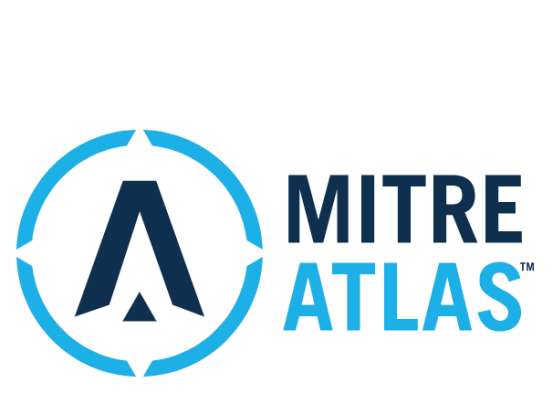

# 面向 AI 安全的诸26种防御措施

## 一、背景

在 AI 的快速演进过程中，安全风险正以前所未有的速度扩散：从 **数据投毒** 到 **模型篡改**，从 **对抗攻击** 到 **供应链漏洞**，AI 的每个生命周期环节都可能成为突破口。
MITRE 作为全球网络安全领域的重要力量，在 2025 年基于 **ATLAS 框架** 提出了 **26 条 AI 安全防御措施**。这份清单不仅是一套“操作手册”，更像是为全球 AI 产业建立的“安全宪法”，为企业和开发者提供了可执行的参考。

## 二、26 条防御措施详解

### 1. 限制公开信息

避免对外披露组织使用的 AI 堆栈细节（如模型架构、数据集来源），减少被攻击者利用的可能。

### 2. 限制模型发布信息

不随意公布模型权重、训练数据或架构信息，防止对手通过这些信息发起灰盒或白盒攻击。

### 3. 被动 AI 输出混淆

在输出层降低保真度，例如只返回必要结果，避免对手通过高质量输出逆推出模型特性。

### 4. 模型强化

采用对抗性训练、知识蒸馏等方法增强模型鲁棒性，使其对对抗性输入更具抵抗力。

### 5. 限制模型查询

限制查询频率和数量，防止对手通过大规模探测推断模型。

### 6. 控制模型访问权限

建立内部模型注册表，严格管控模型和训练数据的访问权限，确保“最小权限原则”。

### 7. 使用模型集成架构

通过模型集成提升鲁棒性，不同模型相互弥补弱点，降低单点突破风险。

### 8. 净化训练数据

对训练集进行清理与过滤，剔除异常或恶意数据。
**方法**：关键词过滤、人工抽样、自动检测结合。

### 9. 验证模型完整性

通过后门触发器检测、概念漂移监控等手段，确认模型运行是否符合预期。

### 10. 使用多模传感器

采用多源数据输入（如图像+文本+声音），避免单一模态被攻击者操控。

### 11. 输入恢复

在推理前对输入进行预处理，消除可能存在的对抗性扰动。

### 12. 限制库加载

避免随意加载第三方库或不受信任的模型文件格式（如 pickle），防止恶意代码注入。

### 13. 加密敏感信息

对模型权重、参数、训练数据进行加密存储，降低被窃取的风险。

### 14. 代码签名

强制执行二进制与应用的数字签名验证，避免恶意代码在 AI 系统中执行。

### 15. 验证 AI 组件

通过校验和验证，确认模型组件未被篡改。

### 16. 对抗性输入检测

在 AI 模型之前加入检测器，识别恶意输入或异常行为。

### 17. 漏洞扫描

定期扫描 AI 模型和依赖库（如 pickle 文件），发现潜在漏洞并及时修补。

### 18. 模型分布

减少边缘设备部署，更多使用云端模型服务，降低攻击者直接访问模型的可能。

### 19. 用户教育

教育开发者掌握 AI 安全编码实践与漏洞防御知识，提高整体安全意识。

### 20. 身份验证

对用户与 API 调用进行严格身份验证，防止模型被滥用。

### 21. 生成式 AI 护栏

在模型输入与输出间增加“护栏”，通过过滤器、规则、NER 等方式限制不当内容生成。

### 22. 生成式 AI 指南

通过系统提示或全局说明，为模型设定角色、目标和安全边界，引导其避免不良输出。

### 23. 生成式 AI 对齐

在训练或微调中应用 **RLHF（人类反馈强化学习）**、安全微调等方法，让模型行为更符合人类价值与安全需求。

### 24. 构建 AI 物料清单（AI BOM）

完整记录 AI 系统构建所需的数据集、模型、依赖库，降低供应链风险。

### 25. AI 日志审计

记录模型输入与输出日志，帮助溯源安全事件，并在攻击发生前发现异常行为。

### 26. 数据集来源管理

追踪和管理训练数据的来源与修改记录，确保其合法性与可信度。

## 三、MITRE 的简单介绍

MITRE 作为美国政府和国际安全界的重要合作伙伴，其提出的防御措施延续了 **CVE、CWE、ATT&CK** 等经典安全标准的理念：

* **可操作性**：不是空洞口号，而是能落地的实践指南。

* **全链路覆盖**：从数据、模型、运行到供应链，形成“纵深防御”。

* **全球影响力**：将成为未来 AI 安全国际标准化的重要参考。

## 四、总结与展望

这 26 条防御措施并不是彼此独立的“零散拼图”，而是可以组合成一个 **系统化的 AI 安全防御网络**：

* 在 **前端**：数据源管理与模型强化；

* 在 **中端**：服务层护栏与对抗性检测；

* 在 **后端**：运行时监控与日志审计。

未来，随着 AI 应用场景不断拓展，这些措施还会不断演化。但它们共同传递一个信号：
**AI 安全不能依赖单一防线，而需要构建“纵深、多层、可追溯”的整体体系。**

一句话总结：**MITRE 的 26 条措施，是全球 AI 安全实践的“工具箱”，为企业构筑稳固的 AI 护城河。**

📌 原文链接：https://mp.weixin.qq.com/s/0lquFfnmN8bvmwrYsBPaOA>
