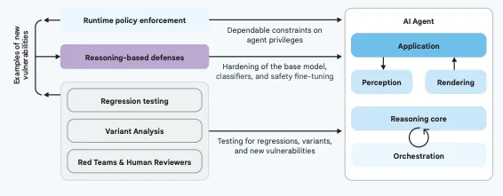
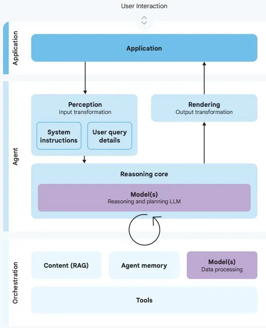
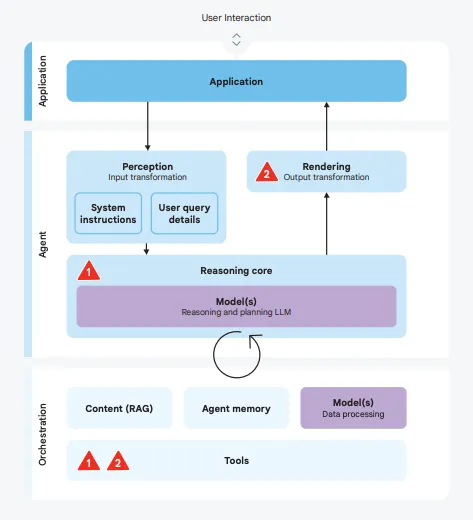
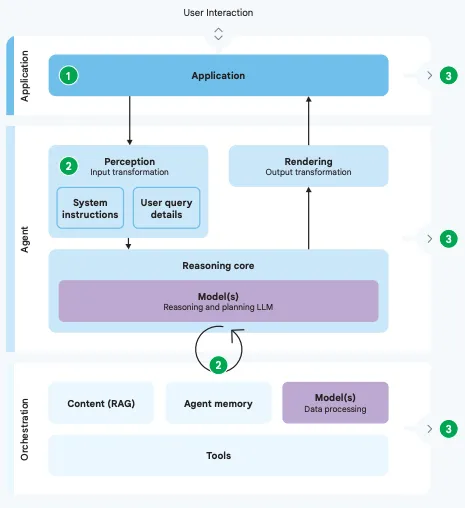

# Google提出的AI Agent纵深安全体系：从风险识别到动态防御的新范式

随着 AI 技术的不断演进，智能体（AI Agent）正逐步走向实际应用场景：它们能代替人类执行复杂任务、调用外部工具、处理多模态数据。但与此同时，伴随而来的安全风险也在急速放大。
如果没有系统性的防护，智能体可能成为数据泄露、越权操作甚至现实世界损害的“桥梁”。

Google 在 2025 年提出了一套 **AI Agent 安全框架**，其核心理念是：**通过风险识别—安全原则—多层防御的闭环机制，为智能体的可扩展应用奠定安全基础**。这套体系不仅是规则层面的限制，更是结合推理能力的纵深防御实践。

## 两大核心风险

Google 将智能体面临的风险聚焦为两大类：**异常行为（Rogue Actions）** 和 **敏感数据泄露（Sensitive Data Disclosure）**。

### 1. 异常行为（Rogue Actions）

异常行为指 AI Agent 偏离预期、执行有害或不合规的操作。产生原因主要包括：

* **提示注入（Prompt Injection）**：攻击者在邮件、网页或文件中嵌入恶意指令，智能体被误导执行攻击者意图。例如，一封精心设计的邮件可能让智能体“主动”将内部报告发送给攻击者。

* **模型误解/对齐问题（Misalignment）**：即使没有恶意输入，模糊指令也可能触发错误。例如“给Mike发项目进展邮件”，智能体可能误选收件人，导致信息泄露。

* **外部交互误解（External Interaction Misinterpretation）**：当智能体调用外部工具或复杂网站时，错误的参数或按钮操作可能触发严重后果，如误下单或非预期数据提交。

**潜在影响**：财务损失、数据泄漏、系统中断、品牌声誉受损，甚至物理层面的安全风险。风险程度通常与智能体所掌控的工具权限成正比。

### 2. 敏感数据泄露（Sensitive Data Disclosure）

数据泄露是另一类关键风险，通常以更隐蔽的方式出现：

* **数据外泄（Data Exfiltration）**：攻击者引导智能体执行特定操作，让敏感信息在副作用中“顺带”泄露。比如将机密数据拼接到 URL 参数中或藏在 Git 提交信息里。

* **输出操控（Output Manipulation）**：攻击者诱导模型直接生成包含敏感数据的输出（如 Markdown 链接或图片 URL）。如果应用缺乏渲染防护，这些数据会在浏览器中被自动请求，进一步导致泄露甚至触发 XSS。

**潜在影响**：隐私被窃取、知识产权流失、合规风险、长期账户安全受损，往往不可逆转。

## 三大安全原则

为应对这些风险，Google 提炼了 **3 项智能体开发与运维原则**：

### 原则 1：必须有明确的人类控制者

* **清晰授权**：每个智能体都要有唯一、可信的人类监督者，系统能区分合法指令与潜在攻击输入。

* **关键操作二次确认**：删除数据库、转账、修改安全策略等操作必须请求用户确认。

* **多用户场景隔离**：在团队环境中，智能体应有独立身份与精细化权限，避免跨用户误触发。

👉 **核心措施**：建立 **Agent User Controls**（用户控制机制），确保智能体身份独立、输入通道安全。

### 原则 2：权限必须受限

* **用途对齐**：智能体的权限需严格符合任务目标。写作助手不应具备删除文件权限，研究助手也不应修改银行数据。

* **动态权限收紧**：不仅仅是最小化权限，还要根据上下文与任务动态调整。

* **权限上限管控**：禁止智能体“自我升级”权限，用户应随时能撤销其能力。

👉 **核心措施**：建立 **Agent Permissions**（权限控制），依托认证、授权和审计（AAA）体系，落实精细化管控。

### 原则 3：行为与规划必须可观察

* **全链路日志**：记录输入、工具调用、输出、参数，甚至推理路径，且需安全存储。

* **操作标注**：所有操作都需标识属性：只读/写入？是否涉及敏感数据？

* **界面透明度**：用户界面应展示智能体“思考过程”和数据来源，在高风险操作前明确提示。

👉 **核心措施**：建立 **Agent Observability**（可观察性控制），通过集中日志和标准化 API 实现可审计、可追踪。

| 安全原则                | 核心要求                             | 控制措施                             |
| ------------------- | -------------------------------- | -------------------------------- |
| **原则1：必须有明确的人类控制者** | - 明确智能体控制用户- 关键操作需确认- 多用户场景下权限隔离 | Agent User Controls（独立身份、安全通道）   |
| **原则2：权限必须受限**      | - 权限与用途对齐- 动态收紧权限- 严格禁止自我提权      | Agent Permissions（认证、授权、审计体系）    |
| **原则3：行为与规划必须可观察**  | - 全链路日志记录- 操作标注属性- 界面透明化展示       | Agent Observability（集中日志+标准化API） |

## 两层纵深防御策略

Google 提出结合 **确定性措施 + 推理防御** 的双层策略，打造“纵深防御”（Defense-in-Depth）：

### 第一层：确定性防护（Deterministic Safeguards）

* **手段**：基于策略引擎的规则限制，如金额超过上限则阻止支付、检测到可疑输入则禁止外发邮件。

* **优势**：稳定、可预测、易审计。

* **局限**：难覆盖复杂场景，缺乏上下文灵活性。

### 第二层：基于推理的防御（Reasoning-based Defenses）

* **手段**：利用 AI 模型本身的能力识别和化解风险，例如：

  * 对抗训练（让模型学会忽略恶意指令）；

  * 防护模型检测输入输出中的可疑信号；

  * 分析智能体计划，提前预测潜在风险。

* **优势**：能应对复杂、动态的攻击模式，提升攻击者成本。

* **局限**：依赖模型质量和对齐程度，仍需与确定性策略结合。

| 层级            | 核心思想       | 主要手段               | 优势            | 局限性            |
| ------------- | ---------- | ------------------ | ------------- | -------------- |
| **第一层：确定性防护** | 策略引擎拦截行为   | - 规则评估- 硬性限制- 用户确认 | 稳定、可预测、易审计    | 难覆盖复杂场景，缺乏上下文  |
| **第二层：推理防御**  | 利用模型推理识别风险 | - 对抗训练- 防护模型- 计划分析 | 适应动态攻击，识别复杂场景 | 依赖模型质量，需与策略层结合 |

## 总结：智能体安全的未来方向

Google 的 AI Agent 安全框架从 **风险识别 → 原则约束 → 策略落地** 构建了一个完整闭环。
它不仅是安全机制的汇总，更是一种 **哲学转变**：从“防止模型出错”转向“如何在复杂生态中保证智能体行为可控”。

对于开发者与企业而言，这意味着：

* 在设计之初就要嵌入安全考量；

* 不仅依赖静态规则，还要发挥 AI 自身的推理检测能力；

* 安全与实用性之间的平衡将决定智能体能否真正走向规模化应用。

换言之，AI Agent 的未来能否普及，不仅取决于它们的“聪明程度”，更取决于我们能否让它们在 **人类监督下安全工作**。

📌 **原文链接**：https://mp.weixin.qq.com/s/0kq-jIpBcSIsAbeKn26z8Q](https://mp.weixin.qq.com/...)
