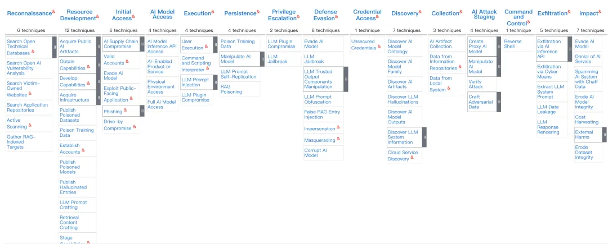

# 面向 AI 的 15 个攻击策略

（MITRE ATLAS, 2025）

## 一、背景

在传统网络安全领域，MITRE 的 **ATT&CK 框架** 已成为安全从业者的“作战地图”，为攻防双方提供了一个标准化的威胁知识库。
而随着人工智能逐渐成为企业、科研机构乃至国家关键基础设施的“底座”，AI 的独特安全风险愈发凸显：

* 它既依赖于数据，又可能泄露数据；

* 它既是生产力工具，也可能被滥用为攻击工具；

* 它的复杂性和黑箱性让传统安全方法难以完全适配。

MITRE 在此背景下提出了 **ATLAS（Adversarial Threat Landscape for Artificial-Intelligence Systems）** 框架，专门研究和总结针对 AI 系统的攻击模式与防御思路。

在 2025 年发布的最新版本中，ATLAS 将攻击链路归纳为 **15 个关键阶段**，从最初的侦察到最终的破坏，几乎覆盖了 AI 生命周期的所有环节。

这 15 个阶段不仅展示了攻击者的“作战路径”，也为防御者提供了一份“红蓝对抗清单”。下面我们逐一展开。

## 二、15 大攻击策略深度解析

### 1. 侦察（Reconnaissance）

**攻击原理**
攻击者通过被动或主动手段收集目标组织及其 AI 系统的关键信息。
包括：模型类型、使用场景、公开的 API 文档、研究论文细节、员工社交媒体信息等。

**典型场景**

* 利用搜索引擎与代码库，发现企业在 GitHub 上泄露的模型配置文件；

* 对目标网站进行爬取，收集其所用 RAG 知识库结构。

**潜在影响**
一旦攻击者掌握了足够的信息，就能 **定制化攻击样本**，提高成功率。

**防御启示**
减少对外披露的敏感信息；对员工进行信息安全培训，避免无意间“自曝家底”。

### 2. 资源开发（Resource Development）

**攻击原理**
在正式进攻前，攻击者需要准备“武器库”。这包括伪造数据集、构建恶意模型、搭建控制服务器等。

**典型场景**

* 向开源社区上传带有隐性后门的“热门数据集”；

* 在 Hugging Face 发布经过篡改的预训练模型，诱导开发者下载使用。

**潜在影响**
受害者在不知情的情况下，将恶意资源纳入生产环境，埋下长期隐患。

**防御启示**
加强供应链治理，验证第三方数据与模型的来源和完整性。

### 3. 初始访问（Initial Access）

**攻击原理**
通过各种手段进入目标 AI 系统，包括供应链攻击、钓鱼、恶意软件注入等。

**典型场景**

* 攻击者利用钓鱼邮件获取研发人员账号，从而访问内部模型仓库；

* 通过植入恶意插件进入 AI 应用的运行环境。

**潜在影响**
一旦获得初始入口，攻击者可以在企业内部横向移动，寻找更有价值的目标。

**防御启示**
采用多因子认证、零信任访问机制，减少单点突破的风险。

### 4. AI 模型访问（AI Model Access）

**攻击原理**
攻击者尝试获取对模型的直接或间接访问。
这可能是 **黑盒访问**（通过 API 调用），也可能是 **白盒访问**（直接获取权重文件）。

**典型场景**

* 滥用推理 API 大量查询，推断模型参数；

* 利用缓存与日志文件泄露，间接获得模型运行数据。

**潜在影响**
可能导致模型被克隆、知识产权丧失，甚至使对手复现功能相近的“盗版模型”。

**防御启示**
控制访问权限，对调用进行速率限制，采用水印等技术检测是否存在大规模抽取。

### 5. 执行（Execution）

**攻击原理**
让 AI 系统执行攻击者的指令或恶意代码。

**典型场景**

* 向 LLM 提交特制 Prompt，让其泄露系统提示（system prompt）；

* 劫持插件调用链条，间接执行不安全操作。

**潜在影响**
可能造成敏感数据暴露、非法指令执行，甚至破坏系统完整性。

**防御启示**
对输入进行过滤，限制模型调用的外部接口；在输出阶段增加检测机制。

### 6. 持久性（Persistence）

**攻击原理**
即使系统重启或管理员清理，攻击者仍能保持对系统的控制。

**典型场景**

* 在训练集或 RAG 知识库中植入持久性恶意数据；

* 篡改模型权重，使其带有后门触发器。

**潜在影响**
攻击持续存在，企业难以彻底根除威胁。

**防御启示**
定期审查数据与模型完整性；建立持续的红蓝对抗机制。

### 7. 权限提升（Privilege Escalation）

**攻击原理**
利用漏洞或逻辑缺陷，获取比原本更高的系统权限。

**典型场景**

* 诱导 LLM 越权访问数据库；

* 插件被劫持后可直接执行系统命令。

**潜在影响**
攻击者可从普通用户身份，跃升为管理员或系统控制者。

**防御启示**
实施最小权限原则，对关键资源访问必须进行人工审批。

### 8. 防御规避（Defense Evasion）

**攻击原理**
攻击者通过混淆、伪装等方式逃避安全检测。

**典型场景**

* 使用多语言混合提示绕过过滤；

* 在数据集中混入“无害外壳”以掩盖恶意内容。

**潜在影响**
攻击活动长期潜伏而不被发现。

**防御启示**
建立多层检测机制，结合语义理解与统计异常检测。

### 9. 凭证访问（Credential Access）

**攻击原理**
窃取系统凭证、API Token、加密密钥。

**典型场景**

* 扫描日志文件，找到未加密的 API Key；

* 通过 Prompt 注入诱导模型“泄露”配置内容。

**潜在影响**
凭证一旦丢失，攻击者即可调用系统资源，造成连锁风险。

**防御启示**
敏感凭证必须加密存储；监控调用频率与位置，异常访问需立即告警。

### 10. 探索（Discovery）

**攻击原理**
在渗透系统后，攻击者进一步探索环境，绘制攻击地图。

**典型场景**

* 通过反复输入查询，逐渐推测系统提示（system prompt）；

* 扫描文件系统，寻找训练数据与模型工件。

**潜在影响**
攻击者对目标环境了如指掌，后续攻击更精准。

**防御启示**
实施分区隔离；对 AI 系统交互行为进行异常检测。

### 11. 收集（Collection）

**攻击原理**
收集有价值的数据与工件。

**典型场景**

* 导出模型权重；

* 收集用户输入日志；

* 打包训练语料。

**潜在影响**
知识产权损失、用户隐私泄漏。

**防御启示**
实施数据访问审计，限制导出行为，确保敏感数据全程加密。

### 12. AI 攻击阶段准备（AI Attack Staging）

**攻击原理**
在正式发起攻击前，对目标进行“彩排”。

**典型场景**

* 构建目标代理模型进行模拟攻击；

* 制造并测试对抗样本。

**潜在影响**
攻击者成功率大幅提升。

**防御启示**
建立蜜罐与诱捕系统，让攻击者的测试暴露其痕迹。

### 13. 命令与控制（Command & Control）

**攻击原理**
建立与目标的隐蔽通信通道。

**典型场景**

* 通过伪装成合法流量维持远程控制；

* 利用 LLM 作为中转工具，传递恶意指令。

**潜在影响**
AI 系统可能成为“僵尸网络”节点。

**防御启示**
监控流量模式，识别异常通信，及时隔离。

### 14. 数据窃取（Exfiltration）

**攻击原理**
将敏感数据或知识产权传输到外部。

**典型场景**

* 利用推理 API 抽取训练数据；

* 将结果分片嵌入正常输出逐步外传。

**潜在影响**
直接经济损失，核心技术外泄。

**防御启示**
部署数据防泄漏（DLP）系统，对异常输出进行检测。

### 15. 影响（Impact）

**攻击原理**
攻击的最终目标：破坏、操纵或制造混乱。

**典型场景**

* 发起算力攻击，使云账单暴涨；

* 投毒导致医疗诊断模型输出错误结果。

**潜在影响**
可能引发 **经济损失、社会动荡，甚至国家安全风险**。

**防御启示**
强化应急预案，建立“熔断”机制，在异常情况下快速停止 AI 系统。

## 三、MITRE ATLAS 的简单介绍

MITRE是一家专注于网络安全与航空科技的非盈利组织，作为美国政府的重要研发合作伙伴，MITRE在国防（如建立首个现代化防空系统）、医疗（如助力新冠研究）、生物科技及网络安全等关键领域持续贡献核心力量。尤为重要的是，其创立的CVE、CWE标准已成为全球漏洞识别的基石，其ATT&CK框架则引领着网络攻防对抗的前沿发展。

1. **全链条覆盖**：从最初侦察到最终影响，完整还原攻击者路径。

2. **实战导向**：基于真实案例与模拟实验，具有可操作性。

3. **国际标准化潜力**：有望与 CVE、ATT&CK 一样，成为全球 AI 安全研究与防御的标准坐标。

4. **攻防对照**：既是攻击蓝图，也是防御清单，帮助红队演练与蓝队加固。

## 四、总结

AI 的独特性决定了它的安全挑战：

* 攻击者可以通过 AI 进行自动化攻击，提升效率；

* 防御者必须借助 AI 来检测和应对威胁。

这是一场 **动态博弈**：

* 攻击不断创新，

* 防御必须迭代，

* 谁能在攻防赛跑中更快，就能主导未来的 AI 安全格局。

一句话总结：**理解 MITRE ATLAS 的 15 个攻击阶段，不仅是研究攻击者的思维方式，更是构筑 AI 安全护城河的第一步。**

📌 原文链接：https://mp.weixin.qq.com/s/3oDOnSW-g20qXKVqKI__LQ
